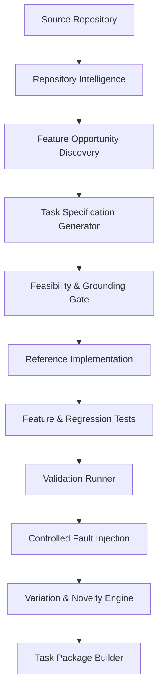

# VeriLoom

> **Repository-Aware Coding Task Factory & Benchmark Validation Platform**

VeriLoom is an automated, repository-grounded pipeline that converts real software codebases into reproducible, independently verified feature-development challenges for evaluating frontier AI coding models.

---

## Key Capabilities

- **Repository Intelligence**: Automatically analyzes codebases, detects stack dependencies, parses AST symbols, and discovers candidate extension points.
- **Specification Generation**: Synthesizes structured, testable functional requirements with observable acceptance criteria and boundary edge cases.
- **Feasibility & Grounding Gates**: Validates that all candidate tasks are strictly grounded in existing codebase symbols before code generation.
- **Reference Solution Workflow**: Builds and checks minimal, repository-compliant reference patches against pinned starting commits.
- **Black-Box Feature Testing**: Creates deterministic unit/integration test suites derived directly from acceptance criteria.
- **Regression Protection**: Enforces baseline test integrity to ensure zero newly introduced regressions.
- **Adversarial Test Strength (Fault Injection)**: Automatically mutates reference solutions (operator inversions, boundary shifts, condition omissions) to verify that generated tests reliably kill faulty implementations.
- **Behavioural Variation Engine**: Enforces multi-dimensional diversity (business rules, state transitions, constraints) using Jaccard tag and AST distance metrics.
- **Self-Contained Task Packages**: Exports version-pinned packages containing specifications, patches, test suites, SHA-256 checksums, and verification logs.

---

## Architecture Overview



---

## Quickstart

### Prerequisites
- Python 3.10+
- Git 2.30+

### Installation
```bash
git clone https://github.com/kushprajapati2202/VeriLoom.git
cd VeriLoom
pip install -r requirements.txt
```

### Running Tests
```bash
pytest
```

---

## CLI Usage

VeriLoom provides a comprehensive CLI for running individual stages or the entire end-to-end factory:

### 1. Inspect Repository & Pin Commit
```bash
python -m veriloom inspect .
```

### 2. Discover Grounded Feature Opportunities
```bash
python -m veriloom opportunities .
```

### 3. Run End-to-End Pipeline & Generate Validated Package
```bash
python -m veriloom run-pipeline . --candidate-index 0
```

### 4. Independent Package Replay & Cryptographic Verification
```bash
# Replay the pre-validated sample package (immediate out-of-the-box verification):
python scripts/replay_package.py --package ./examples/sample_packages/pkg_task_48e3bf

# Or verify any newly generated package:
python -m veriloom verify-package --package-dir ./exports/<pkg_dir>
```

### 5. AI Coding Model Benchmarking & Evaluation Harness
Score candidate AI coding models or agent patches against verified task packages with automated feature and regression tests:
```bash
# Evaluate a passing candidate solution patch:
python -m veriloom benchmark --package ./examples/sample_packages/pkg_task_48e3bf --solution ./examples/sample_packages/pkg_task_48e3bf/reference/implementation.patch --model "gemini-2.5-pro"

# Evaluate a faulty solution (demonstrating failure classification):
python -m veriloom benchmark --package ./examples/sample_packages/pkg_task_48e3bf --solution "def broken(): pass" --model "flawed-agent"
```

### 6. Interactive Engineering Dashboard & REST API
Launch the unified FastAPI control center and visual dashboard:
```bash
python -m veriloom serve --port 8000
```
Open [http://127.0.0.1:8000/dashboard](http://127.0.0.1:8000/dashboard) in your browser for the real-time pipeline visualizer and task catalog. OpenAPI specifications are available at `http://127.0.0.1:8000/docs`.

---

## Cloud Deployment

VeriLoom is pre-configured for 1-click cloud deployment:

### 1. Deploy on Vercel
1. Import `kushprajapati2202/VeriLoom` on [vercel.com](https://vercel.com).
2. Vercel automatically detects `vercel.json` and `api/index.py`.
3. Click **Deploy**. Your dashboard will be live at `https://<your-project>.vercel.app/dashboard`.

### 2. Deploy via Docker (Render / Railway / Hugging Face Spaces)
The repository includes a production-ready `Dockerfile` and `Procfile`:
- **Render**: Create New Web Service $\to$ Select `kushprajapati2202/VeriLoom` $\to$ Deploy.
- **Railway**: New Project $\to$ Deploy from GitHub repo $\to$ Generate Domain.
- **Hugging Face Spaces**: Create Space $\to$ Choose Docker $\to$ Connect GitHub.

---

## Quality Gates Enforced

- **Grounding Gate**: Rejects any candidate task lacking verified AST symbol evidence.
- **Feasibility Gate**: Enforces unambiguous acceptance criteria and maps every requirement to tests.
- **Regression Protection**: Ensures 0 newly introduced failures on baseline test suites.
- **Controlled Fault Injection**: Tests reference solutions against synthesized mutants (operator inversions, boundary shifts, condition omissions) to prove tests catch defects.
- **Behavioural Variation**: Computes 4-factor distance $D(T_A, T_B)$ to reject cosmetic paraphrases.
- **Package Integrity**: Pinned commit metadata, patches, tests, and validation logs with SHA-256 verification.

---

## License
MIT License.

