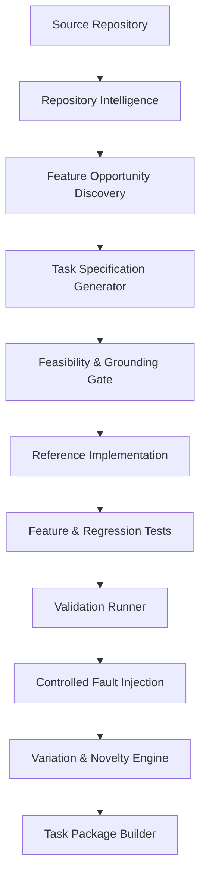

# VeriLoom (CodeForge AI)

> **Repository-Aware Coding Task Factory & Benchmark Validation Platform**

VeriLoom is an automated, repository-grounded pipeline that converts real software codebases into reproducible, independently verified feature-development challenges for evaluating frontier AI coding models.

---

## Key Capabilities

- **Repository Intelligence**: Automatically analyzes codebases, detects stack dependencies, parses AST symbols, and discovers candidate extension points.
- **Specification Generation**: Synthesizes structured, testable functional requirements with observable acceptance criteria and boundary edge cases.
- **Feasibility & Grounding Gates**: Validates that all candidate tasks are strictly grounded in existing codebase symbols before code generation.
- **Reference Solution Workflow**: Builds and checks minimal, repository-compliant reference patches against pinned starting commits.
- **Black-Box Feature Testing**: Creates deterministic unit/integration test suites derived directly from acceptance criteria.
- **Regression Protection**: Enforces baseline test integrity to ensure zero newly introduced regressions.
- **Adversarial Test Strength (Fault Injection)**: Automatically mutates reference solutions (operator inversions, boundary shifts, condition omissions) to verify that generated tests reliably kill faulty implementations.
- **Behavioural Variation Engine**: Enforces multi-dimensional diversity (business rules, state transitions, constraints) using Jaccard tag and AST distance metrics.
- **Self-Contained Task Packages**: Exports version-pinned packages containing specifications, patches, test suites, SHA-256 checksums, and verification logs.

---

## Architecture Overview



---

## Quickstart

### Prerequisites
- Python 3.10+
- Git 2.30+

### Installation
```bash
git clone https://github.com/kushprajapati2202/VeriLoom.git
cd VeriLoom
pip install -r requirements.txt
```

### Running Tests
```bash
pytest
```

---

## License
MIT License.
